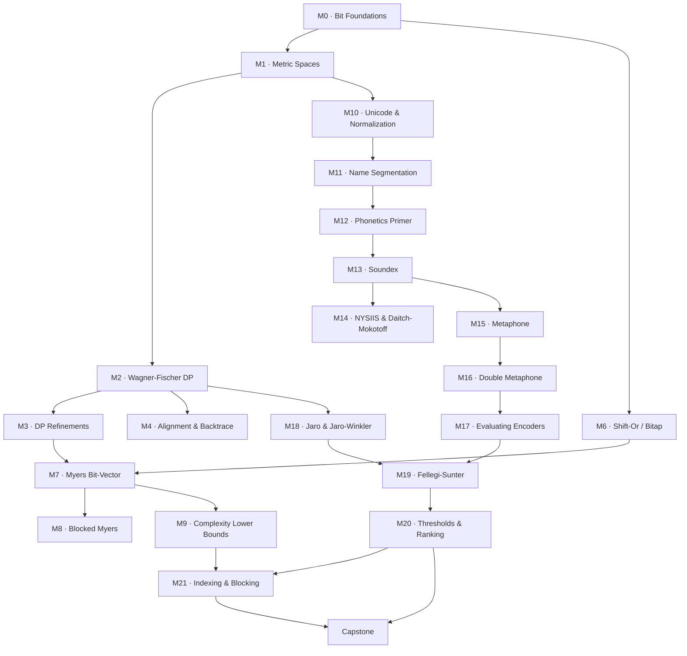

# Fuzzy Name Matching: A Curriculum From First Principles

> [!abstract] What this is
> A ==complete, source-backed study path== for every algorithm in the `fuzzy-names` TypeScript library — built so that by the end you could **re-derive and re-implement the entire library from scratch**, justify every design decision, and know exactly where each decision is wrong.
>
> It is not a survey. Each module has a **theory half** (derive it on paper) and an **engineering half** (read the real implementation, break it, fix it). The repository is the lab bench throughout.

---

## 0. How to use this curriculum

> [!tip] The method
> Each module follows the same five beats. Do not skip beat 2 — it is the one that actually builds the intuition.
>
> 1. **Motivate** — what breaks without this algorithm? Read the problem statement before the solution.
> 2. **Derive by hand** — work the algorithm on paper with a tiny input (3–6 characters) *before* reading any code. Fill the DP table yourself. Trace the bit vectors yourself.
> 3. **Read the primary source** — the original paper, not a blog post about the paper. Blog posts are for unblocking, not for learning.
> 4. **Implement from the spec** — write it in TypeScript from your notes, with the paper closed.
> 5. **Differential-test against the reference** — your implementation vs. the library's, on random inputs, until they agree on a million cases.

### Progress tracking

Check these off as you go. Each is a *verifiable* milestone, not a reading assignment.

- [ ] **P0** Bit manipulation fluency — [[#Phase 0 · Foundations]]
- [ ] **P1** Can fill a Wagner–Fischer table and recover the alignment by backtrace
- [ ] **P2** Can derive Myers' five bitwise update lines from the DP recurrence
- [ ] **P3** Can explain, from the Unicode spec, why `deburr` is not `NFD`
- [ ] **P4** Can hand-encode a name in Soundex, Metaphone, and Double Metaphone
- [ ] **P5** Can compute Fellegi–Sunter match weights and set thresholds from a target error rate
- [ ] **P6** Can make a 1M-name corpus searchable in sub-millisecond time
- [ ] **CAP** Capstone shipped — [[#Phase 6 · Capstone]]

### Suggested vault structure

This note is the **map of content (MOC)**. Create one note per module as you work through it; the wikilinks below are deliberately left unresolved so Obsidian will create them on click.

```
Fuzzy Name Matching/
├── Fuzzy Name Matching — Curriculum.md   ← this note
├── Modules/
│   ├── M01 Strings and Metric Spaces.md
│   ├── M02 Wagner-Fischer.md
│   └── ...
├── Derivations/      ← your by-hand paper work, photographed or typed
├── Implementations/  ← your from-scratch code, one folder per module
└── Benchmarks/       ← measurements, never guesses
```

### Module dependency graph



### Coverage map — curriculum module → library artifact

Every algorithm identified in the codebase, and where it is taught.

| Library artifact | Algorithm | Module |
|---|---|---|
| `src/utils/lev.ts` → `myers_32` | Myers bit-parallel edit distance (single word) | [[M07 Myers Bit-Vector Algorithm\|M7]] |
| `src/utils/lev.ts` → `myers_x` | Blocked bit-parallel edit distance | [[M08 Blocked Myers\|M8]] |
| `src/utils/lev.ts` → `distance` | Dispatch, swap, trivial cases | [[M02 Wagner-Fischer\|M2]], [[M07 Myers Bit-Vector Algorithm\|M7]] |
| `src/utils/lev.ts` → `peq` | Pattern-match bitmask preprocessing | [[M06 Shift-Or and Bitap\|M6]] |
| `src/utils/lev.ts` → `closest` | Linear nearest-neighbour scan (argmin) | [[M21 Indexing and Blocking\|M21]] |
| `src/calculate-lev-distance.ts` | Component-wise distance decomposition | [[M05 Field-Wise Decomposition\|M5]] |
| `src/normalize.ts` | Diacritic folding, case folding, filtering | [[M10 Unicode and Normalization\|M10]] |
| `src/split.ts` | Positional name segmentation | [[M11 Name Segmentation\|M11]] |
| `natural.SoundEx` | Soundex phonetic encoding | [[M13 Soundex\|M13]] |
| `natural.Metaphone` | Metaphone phonetic encoding | [[M15 Metaphone\|M15]] |
| `natural.DoubleMetaphone` | Double Metaphone, primary + alternate | [[M16 Double Metaphone\|M16]] |
| `src/calculate-phonetics-metric.ts` | Score aggregation over encoders × fields | [[M17 Evaluating Phonetic Encoders\|M17]] |
| `src/search.ts` → threshold filter | Decision rule, precision/recall trade-off | [[M19 Fellegi-Sunter\|M19]], [[M20 Thresholds and Ranking\|M20]] |
| `src/search.ts` → `orderBy` | Lexicographic multi-key stable ranking | [[M20 Thresholds and Ranking\|M20]] |
| `src/search.ts` → `getMatchItemStr` | Path resolution / field extraction | [[M11 Name Segmentation\|M11]] |
| *(absent — taught as contrast)* | Jaro, Jaro–Winkler, q-grams | [[M18 Jaro and Jaro-Winkler\|M18]] |
| *(absent — taught as contrast)* | BK-trees, Levenshtein automata, LSH | [[M21 Indexing and Blocking\|M21]] |

---

## Phase 0 · Foundations

> [!info] Goal
> Remove every prerequisite gap that would make Phase 2 feel like magic. If you can already do the Phase 0 exit test cold, skip to Phase 1.
>
> **Time:** 4–8 hours.

### M0 · Bit manipulation and machine words

> [!question]- Why this comes first
> Myers' algorithm is the intellectual centre of this library, and it is *entirely* bit tricks. People bounce off it not because the DP is hard but because `(((Eq & Pv) + Pv) ^ Pv)` is opaque. It stops being opaque once you understand carry propagation as a primitive.

**Learn:**

- Two's complement; why `-1` is all-ones and why that matters for initialising a "all deltas are +1" vector.
- Shifts: logical vs. arithmetic (`>>` vs. `>>>` in JavaScript), and what shifting in a `1` vs. a `0` means semantically.
- Masks: setting, clearing, testing bit $i$; extracting the top bit.
- **Carry propagation as computation.** This is the keystone. The expression `(x + y) ^ y` uses the adder's carry chain to propagate information *across* bit positions — something no pure bitwise operator can do, since `&`, `|`, `^`, `~` are all bit-local. An addition is the only way to make bit $i$ influence bit $i+k$ in $O(1)$.
- JavaScript specifics: bitwise operators coerce to **int32**, so `|0` truncation and sign behaviour are load-bearing; `Uint32Array` for unsigned storage.

> [!warning] The JavaScript trap
> `1 << 31` is negative in JS. `x >>> 0` converts to unsigned. The library's `myers_32` uses signed 32-bit arithmetic throughout and relies on `-1` meaning "all 32 bits set". Confirm you understand why `let pv = -1` is the correct initialisation for "every vertical delta is $+1$".

**Exercises:**

1. Write `popcount(x: number): number` three ways: naive loop, Kernighan's `x & (x-1)`, and the SWAR bit-twiddling version. Benchmark all three.
2. Given a 32-bit mask, write `lowestSetBit`, `clearLowestSetBit`, `isolateHighestSetBit` without branches.
3. **The important one.** Let `x = 0b00111000` and `y = 0b00001000`. Compute `(x + y) ^ y` by hand, in binary, showing the carry chain. Now explain in one sentence what information travelled from bit 3 to bit 6.
4. Implement a 64-bit unsigned shift-left across a `[lo, hi]` pair of int32s. (You will need the concept in [[M08 Blocked Myers|M8]].)

**Resources:**

- *Hacker's Delight*, Henry S. Warren Jr. — chapters 2 and 5. The reference work.
- [Bit Twiddling Hacks](https://graphics.stanford.edu/~seander/bithacks.html), Sean Eron Anderson.

**Checkpoint:** Explain, without notes, why bitwise operators alone cannot compute a DP column, and what addition buys you.

^m0-checkpoint

---

## Phase 1 · Edit distance theory

> [!info] Goal
> Understand edit distance as a mathematical object first, an algorithm second. Everything in `src/utils/lev.ts` is an optimisation of one recurrence — you must know that recurrence cold.
>
> **Time:** 2 weeks.

### M1 · Strings, distances, and metric spaces

**Learn:**

- Alphabet $\Sigma$, strings $\Sigma^*$, the free monoid, prefixes/suffixes/subsequences/substrings — and why confusing *subsequence* with *substring* costs people hours.
- **The metric axioms.** A function $d: X \times X \to \mathbb{R}_{\ge 0}$ is a metric iff:
	1. $d(x,y) \ge 0$ (non-negativity)
	2. $d(x,y) = 0 \iff x = y$ (identity of indiscernibles)
	3. $d(x,y) = d(y,x)$ (symmetry)
	4. $d(x,z) \le d(x,y) + d(y,z)$ (**triangle inequality**)
- **Why axiom 4 is the one that pays.** The triangle inequality is what makes metric indexing possible. If you know $d(q, p) = 5$ and you want all $x$ with $d(q,x) \le 2$, then any $x$ with $|d(p,x) - 5| > 2$ can be discarded *without computing $d(q,x)$*. That single observation is the whole of BK-trees in [[M21 Indexing and Blocking|M21]].
- The edit-distance family as a design space: which operations, at what cost?

| Distance | Operations | Metric? |
|---|---|---|
| Hamming | substitution only (equal lengths) | yes |
| **Levenshtein** | insert, delete, substitute — unit cost | **yes** |
| LCS / indel | insert, delete only | yes |
| Damerau–Levenshtein (restricted) | + adjacent transposition | **no** — fails triangle inequality |
| Damerau–Levenshtein (unrestricted) | + transposition, unrestricted | yes |
| Weighted / generalised | per-operation-pair costs | only if costs form a metric |
| Jaro, Jaro–Winkler | — (similarity, not a distance) | **no** |

> [!danger] Correctness trap
> The *restricted* Damerau–Levenshtein distance (optimal string alignment, OSA) is the version most people implement, and it is **not a metric**: $d(\text{CA}, \text{ABC}) = 3$ under OSA but $2$ under true Damerau. Indexing structures that assume the triangle inequality will silently return wrong results if fed OSA.

**Prove these yourself** (do not look them up):

1. Levenshtein distance satisfies the triangle inequality. *Hint: compose the two optimal edit scripts and argue the composite is a valid — not necessarily optimal — script from $x$ to $z$.*
2. $\big||x| - |y|\big| \le d(x,y) \le \max(|x|,|y|)$. These bounds are the early-exit conditions in every production implementation.
3. If $d(x,y) \le k$ then $x$ and $y$ share a common substring of length $\ge \lfloor \max(|x|,|y|)/(k+1) \rfloor$ (the pigeonhole / $q$-gram lemma). This is the theoretical basis for filtering in [[M21 Indexing and Blocking|M21]].

**Checkpoint:** State which of the library's two scoring dimensions (`levDistance.total`, `phoneticsMetric`) is a metric, and what that implies about which one can be indexed.

### M2 · Wagner–Fischer: the dynamic programming solution

> [!quote] Primary source
> Robert A. Wagner and Michael J. Fischer, **"The String-to-String Correction Problem"**, *Journal of the ACM* 21(1):168–173, January 1974. [DOI 10.1145/321796.321811](https://dl.acm.org/doi/10.1145/321796.321811) · [PDF mirror](https://par.cse.nsysu.edu.tw/resource/lab_relative/Wagn74.pdf) · [Wikipedia overview](https://en.wikipedia.org/wiki/String-to-string_correction_problem)

**Learn:**

Define $D[i,j]$ = edit distance between the first $i$ characters of $a$ and the first $j$ characters of $b$. The recurrence:

$$
D[i,j] = \min
\begin{cases}
D[i-1,j] + 1 & \text{(deletion from } a) \\
D[i,j-1] + 1 & \text{(insertion into } a) \\
D[i-1,j-1] + \mathbb{1}[a_i \ne b_j] & \text{(substitution or match)}
\end{cases}
$$

with base cases $D[i,0] = i$ and $D[0,j] = j$.

Then work through:

- **Why the recurrence is correct** — the optimal-substructure argument. Any optimal edit script's *last* operation must be one of three things; each branch is the cost of that last operation plus the optimal cost of the remaining subproblem.
- **Why greedy fails.** Construct a pair of strings where locally choosing a match produces a globally worse script.
- Complexity: $O(nm)$ time, $O(nm)$ space naively, $O(\min(n,m))$ space if you only need the number.
- **The two-row (rolling array) optimisation** — and exactly what you lose: the ability to backtrace.
- The DP table's structural properties, which Phase 2 will exploit:
	- Adjacent cells differ by at most 1: $|D[i,j] - D[i-1,j]| \le 1$ and $|D[i,j] - D[i,j-1]| \le 1$. ==This is the single most important fact in this curriculum.==
	- Diagonal cells are non-decreasing: $D[i,j] \le D[i-1,j-1] + 1$, and $D[i-1,j-1] \le D[i,j]$.

> [!important] The hinge of the whole library
> Because adjacent cells differ by exactly $-1$, $0$, or $+1$, you never need to store the *values* in a DP column — two bits per cell suffice to store the *delta* from its neighbour. A 32-cell column therefore fits in two 32-bit machine words. **This is the entire idea of Myers' algorithm.** Do not move to Phase 2 until this sentence is obvious to you.

**Exercises:**

1. Fill the full $9 \times 8$ table for `"john"` vs. `"jon"` by hand. Then for `"kitten"`/`"sitting"` (the canonical example, answer 3).
2. Implement `wagnerFischer(a: string, b: string): number[][]` in TypeScript returning the full table.
3. Differential-test it against the library: `import { distance } from "./src/utils/lev"` and assert equality over 100,000 random string pairs of length 1–40 drawn from `[a-z ]`. ==This harness will be reused in every subsequent module — build it properly.==
4. Add unit costs $(c_{\text{ins}}, c_{\text{del}}, c_{\text{sub}})$ as parameters. Under what cost assignment does Levenshtein degenerate into LCS?
5. Verify the delta property empirically: assert that every pair of vertically adjacent cells in your table differs by at most 1, for 10,000 random pairs.

**Checkpoint:** Reproduce the recurrence from memory, state its complexity, and prove the $\pm1$ adjacency property.

### M3 · Refinements: space, bands, and cutoffs

**Learn:**

- **Hirschberg's algorithm** — linear-space alignment via divide and conquer. $O(nm)$ time, $O(\min(n,m))$ space, *and* it recovers the alignment. Understand the "find the crossing point of the optimal path at the middle column" trick.
- **Ukkonen's cutoff / banded DP.** If you only care whether $d(a,b) \le k$, you only need the band of $2k+1$ diagonals around the main diagonal — everything outside it is provably $> k$. Uses diagonal monotonicity: values along each diagonal never decrease. Expected time $O(kn)$; **worst case is still $O(nm)$** — a detail many write-ups get wrong.
	- Ukkonen, "Algorithms for Approximate String Matching", *Information and Control* 64, 1985.
	- [Helsinki SPA lecture notes on the cutoff heuristic](https://cs.helsinki.fi/u/tpkarkka/opetus/13s/spa/lecture08.pdf) — the clearest free treatment.
- Worst-case $O(kn)$ alternatives: Landau–Vishkin, Galil–Park (diagonal-transition methods).
- **Early-exit filters** from M1's bounds: if $\big||a|-|b|\big| > k$, return immediately.

> [!note] Connect it to the code
> `src/utils/lev.ts` implements *none* of these — it always computes the exact distance over the full input. The library then throws most of that work away by comparing against a threshold in `src/search.ts`. Note this now; you will fix it in the [[#Phase 6 · Capstone|capstone]].

**Exercises:**

1. Implement banded DP with a cutoff parameter $k$; verify it agrees with full DP whenever the true distance $\le k$, and correctly reports "> k" otherwise.
2. Benchmark banded vs. full DP across $k \in \{1,2,5,10\}$ on 20-character strings. Plot it. At what $k$ does the band stop paying?
3. Implement Hirschberg's algorithm and recover an actual alignment for a 200-character pair.

### M4 · Alignment, backtrace, and interpretability

**Learn:**

- Recovering the edit script by backtracing through the DP table; handling ties (multiple optimal alignments).
- Counting optimal alignments — a second DP over the same table.
- Why alignment matters for name matching specifically: knowing *that* `"Jon"`→`"John"` costs 1 is less useful than knowing the edit is an **insertion of `h` in position 2**, which is a known orthographic variant rather than a typo.
- Needleman–Wunsch (global) and Smith–Waterman (local) as the affine-gap, scoring-matrix generalisation from bioinformatics — same DP skeleton, richer cost model.

**Exercises:**

1. Extend your Wagner–Fischer implementation to emit an edit script as `Array<{op: 'ins'|'del'|'sub'|'match', at: number, char: string}>`.
2. Build an operation-frequency histogram over a corpus of real name variants (e.g. a nickname list). Which single-character operations dominate? Does that suggest a non-uniform cost model?

### M5 · Field-wise decomposition — the library's actual distance function

> [!example] This module is about a design decision, not an algorithm
> `src/calculate-lev-distance.ts` does **not** compute the edit distance between two names. It computes three separate edit distances — first name, joined middle names, last name — and *sums* them.

**Learn:**

- Formally: given segmentations $a \to (a_f, a_m, a_l)$ and $b \to (b_f, b_m, b_l)$, the library computes
	$$D_{\text{field}}(a,b) = d(a_f,b_f) + d(a_m,b_m) + d(a_l,b_l)$$
	where $d$ is Levenshtein.
- **Is $D_{\text{field}}$ a metric?** Work it out. (Sum of metrics on a product space is a metric — the $L_1$ product metric — *provided the segmentation is a deterministic function of the string*. Think hard about whether that proviso holds here, and what happens when the two names have different numbers of tokens.)
- What this buys: word-order sensitivity, and isolation of an error to one field. `"John Doe"` vs. `"Doe John"` scores badly under $D_{\text{field}}$ and well under plain Levenshtein — which behaviour do you want?
- What this costs: catastrophic failure under token-count mismatch. `"John Doe"` vs. `"John Michael Doe"` puts `""` against `"michael"`, contributing 7 to the total. Compare the alternatives:
	- **Token-sort**: sort tokens alphabetically, then compare — order-insensitive.
	- **Token-set**: compare intersection and differences separately (the `fuzzywuzzy`/RapidFuzz approach).
	- **Optimal assignment**: treat it as bipartite matching between token sets, minimum-cost perfect matching via the Hungarian algorithm. This is what you actually want for names.

**Exercises:**

1. Construct three name pairs where $D_{\text{field}}$ is strictly better than whole-string Levenshtein, and three where it is strictly worse. Justify each.
2. Implement token-set ratio and Hungarian-assignment matching. Compare all four scorers on a hand-built set of 50 hard name pairs (middle-name presence/absence, reordering, hyphenation, patronymics).
3. Prove or disprove: $D_{\text{field}}$ satisfies the triangle inequality over the set of all strings.

**Checkpoint:** Given the library's segmentation rules, construct the input pair that maximises $D_{\text{field}} - d_{\text{whole}}$ for names under 20 characters.

---

## Phase 2 · Bit-parallelism

> [!info] Goal
> Derive Myers' algorithm yourself. Not read it — *derive* it. This is the hardest phase and the most rewarding.
>
> **Time:** 2–3 weeks.

### M6 · Shift-Or / Bitap — bit-parallelism without DP

> [!quote] Primary source
> Ricardo Baeza-Yates and Gaston H. Gonnet, **"A New Approach to Text Searching"**, *Communications of the ACM* 35(10):74–82, 1992. [PDF](https://www.cin.ufpe.br/~paguso/courses/if767/bib/Baeza_1992.pdf) · [Bitap on Wikipedia](https://en.wikipedia.org/wiki/Bitap_algorithm)

Start here, not with Myers. Shift-Or is the simplest useful bit-parallel algorithm and it introduces both of the ideas Myers needs.

**Learn:**

- **Idea 1 — the character bitmask table.** Precompute, for each character $c$, a mask $B[c]$ with bit $i$ set iff $p_i = c$. Cost $O(|\Sigma| + m)$, and after that, "does character $c$ match pattern position $i$?" is a single array read plus a bit test, *for all $i$ simultaneously*.
	- This is exactly the library's `peq: Uint32Array(0x10000)`, indexed by `charCodeAt`.
- **Idea 2 — the state vector.** Keep the entire automaton state (one bit per pattern position) in one machine word; advance it with a shift and a mask. Exact matching becomes:
	$$R' = (R \ll 1) \mid B[c]$$
	(in the "0 means active" convention), reporting a match when bit $m-1$ of $R'$ is 0.
- Complexity: $O(n \lceil m/w \rceil)$ where $w$ is the word size — a constant-factor win of up to $w$ over the naive automaton.
- The approximate-matching extension (Wu–Manber), which keeps $k+1$ state vectors — and why it scales badly in $k$, motivating Myers.
- Where bit-parallelism stops helping: patterns much longer than $w$.

**Exercises:**

1. Implement Shift-Or exact matching in TypeScript for patterns up to 32 characters. Test against `String.prototype.indexOf`.
2. Implement Wu–Manber approximate matching for $k \le 3$.
3. Read `src/utils/lev.ts` lines 1 and 9–11. Explain: why is `peq` sized `0x10000`? What does that assume about the input alphabet? What breaks for an emoji or a CJK ideograph outside the BMP? (Trace through `normalizeName` first and decide whether it can actually happen here.)

> [!bug] Found in the wild
> `peq` is module-level mutable state, zeroed at the end of each call. Work out: (a) how much memory it occupies, (b) why it is zeroed in a second loop rather than reallocated, (c) what happens if `myers_32` throws midway, and (d) whether the function is safe to call re-entrantly from a generator or async context.

### M7 · Myers' bit-vector algorithm ⭐

> [!quote] Primary source
> Gene Myers, **"A Fast Bit-Vector Algorithm for Approximate String Matching Based on Dynamic Programming"**, *Journal of the ACM* 46(3):395–415, May 1999. [ACM DL](https://dl.acm.org/doi/10.1145/316542.316550) · [PDF mirror](https://www.win.tue.nl/~jfg/educ/bit.mat.pdf)
>
> Supporting material:
> - Heikki Hyyrö, "Explaining and Extending the Bit-Parallel Approximate String Matching Algorithm of Myers" (2001) — **read this before the Myers paper**; it is the clearer derivation.
> - Heikki Hyyrö, ["A Note on Bit-Parallel Alignment Computation"](http://stringology.org/cgi-bin/getfile.cgi?t=pdf&c=-&y=2004&n=7) (2004).
> - [FU Berlin lecture slides on bit-parallel verification](https://www.mi.fu-berlin.de/wiki/pub/ABI/RnaSeqP4/myers-bitvector-verification.pdf) — worked diagrams.
> - [CuriousCoding, "Bitpacking and approximate string matching"](https://curiouscoding.nl/posts/approximate-string-matching/) — modern engineering perspective.

> [!tip] This is the centrepiece. Budget a full week.

**The derivation, in the order you should reconstruct it:**

**Step 1 — Change of variable.** Stop storing $D[i,j]$. Store the *deltas*. For column $j$ define:

$$
\begin{aligned}
VP_j[i] &= 1 \iff D[i,j] - D[i-1,j] = +1 \quad \text{(vertical positive)} \\
VN_j[i] &= 1 \iff D[i,j] - D[i-1,j] = -1 \quad \text{(vertical negative)} \\
HP_j[i] &= 1 \iff D[i,j] - D[i,j-1] = +1 \quad \text{(horizontal positive)} \\
HN_j[i] &= 1 \iff D[i,j] - D[i,j-1] = -1 \quad \text{(horizontal negative)}
\end{aligned}
$$

By M2's adjacency property these four vectors fully determine the column. A delta of $0$ is encoded as "neither bit set".

**Step 2 — The match vector.** $Eq = B[b_j]$, bit $i$ set iff $a_i = b_j$. Precomputed as in M6.

**Step 3 — The diagonal-zero vector $D_0$.** Bit $i$ of $D_0$ is set iff $D[i,j] = D[i-1,j-1]$, i.e. the cell took the diagonal with no cost. Myers shows:

$$D_0 = \big(((Eq \mathbin{\&} VP) + VP) \oplus VP\big) \mid Eq \mid VN$$

**The addition is the crux.** $((Eq \mathbin{\&} VP) + VP) \oplus VP$ propagates a carry through each maximal run of set bits in $VP$, which is precisely how a match at position $i$ lets a zero-cost diagonal extend *upward* through positions $i+1, i+2, \dots$ No sequence of bitwise operations can do this; only the adder's carry chain can.

**Step 4 — Horizontal deltas from $D_0$:**

$$HP = VN \mid {\sim}(D_0 \mid VP), \qquad HN = VP \mathbin{\&} D_0$$

**Step 5 — Score update.** The running score is $D[m, j]$. Read bit $m-1$ of $HP$ and $HN$:
- if $HP$'s top bit is set, score $\mathrel{+}= 1$
- if $HN$'s top bit is set, score $\mathrel{-}= 1$

**Step 6 — Shift and recompute vertical deltas for the next column:**

$$HP \mathrel{\ll}= 1, \quad HN \mathrel{\ll}= 1$$
$$VP = HN \mid {\sim}(D_0 \mid HP), \qquad VN = HP \mathbin{\&} D_0$$

**Step 7 — Initialisation and boundary.** $VP = \mathbf{1}^m$ (all ones, i.e. `-1`), $VN = 0$, score $= m$. For *global* edit distance, shift a $1$ into $HP$; for *approximate substring matching* (Myers' actual problem), shift in a $0$ — because a match may start anywhere in the text. ==Getting this boundary wrong is the single most common implementation bug.==

> [!success] Now map it onto the real code
> Open `src/utils/lev.ts` and read `myers_32` against the derivation above. The library uses the compressed `fastest-levenshtein` formulation that aliases variables to save registers. Verify each of these correspondences yourself:
>
> | Code | Derivation |
> |---|---|
> | `pv`, `mv` (initially `-1`, `0`) | $VP$, $VN$ |
> | `peq[a.charCodeAt(i)] \|= 1 << i` | building $Eq$ masks over `a` |
> | `const xv = eq \| mv` | $Xv = Eq \mid VN$ |
> | `eq \|= ((eq & pv) + pv) ^ pv` | $Xh$ (= $D_0$), **written back into `eq`** |
> | `mv \|= ~(eq \| pv)` | $HP$, **aliased into `mv`** |
> | `pv &= eq` | $HN$, **aliased into `pv`** |
> | `if (mv & lst) sc++` | score $\mathrel{+}=1$ from $HP$ top bit |
> | `if (pv & lst) sc--` | score $\mathrel{-}=1$ from $HN$ top bit |
> | `mv = (mv << 1) \| 1` | $HP \ll 1$, shifting in **1** → global alignment |
> | `pv = (pv << 1) \| ~(xv \| mv)` | $VP = (HN \ll 1) \mid \sim(Xv \mid HP)$ |
> | `mv &= xv` | $VN = HP \mathbin{\&} Xv$ |
>
> Note `sc` starts at `n = a.length`, which is $D[n,0] = n$, and that `lst = 1 << (n-1)` is the top-bit mask. The `| 1` on the $HP$ shift is the global-alignment boundary condition from Step 7 — this is why the function returns edit distance rather than best-substring-match distance.

**Exercises:**

1. **Hand-trace.** `a = "ab"`, `b = "ba"`. Write out `pv`, `mv`, `eq`, `xv`, `xh`, `sc` as 2-bit binary at every iteration. Confirm the answer is 2. Do this on paper before touching a debugger.
2. Implement Myers from your own notes with the paper closed. Expect to get it wrong twice.
3. Differential-test yours vs. `myers_32` vs. your Wagner–Fischer from M2, over $10^6$ random pairs with lengths 0–32. Include empty strings, identical strings, and single-character strings.
4. Benchmark Myers vs. your two-row Wagner–Fischer at lengths 4, 8, 16, 32. Measure, don't guess. At what length does the bit-parallel version start winning, and why is it not immediately?
5. **Deep cut.** Modify your implementation to do approximate *substring* matching (shift in 0, report every end position with score $\le k$). This is what Myers' paper is actually about; the library only uses the degenerate global case.
6. Extend to Damerau–Levenshtein with transpositions, following Hyyrö's 2003 formulation. ([Bit-parallel approximate string matching algorithms with transposition](https://www.sciencedirect.com/science/article/pii/S157086670400053X))

**Checkpoint:** Write out the five update lines from memory, name each vector, and explain in one sentence why the `+` cannot be replaced by `|`.

^m7-checkpoint

### M8 · Blocked Myers — beyond one machine word

**Learn:**

- When the pattern exceeds $w$ bits, partition the DP column into $\lceil m/w \rceil$ blocks of $w$ cells each and process block by block, carrying horizontal deltas between blocks.
- The carry arrays: the library's `phc` / `mhc` hold the horizontal $HP$/$HN$ bits crossing block boundaries. Note `phc[i] = -1, mhc[i] = 0` initialisation — the same "all deltas +1" boundary as the single-word case.
- Complexity $O(\lceil m/w \rceil \cdot n)$; linear in input when $m \le w$.
- Myers' "relocatable dynamic programming" refinement: tracking only the active blocks for $k$-bounded search, which brings it to $O(\lceil k/w \rceil n)$ expected.

**Read the code:** `myers_x` in `src/utils/lev.ts`.

> [!question]- Puzzle: which string gets blocked?
> `distance(a, b)` swaps so that `a` is the **longer** string, then calls `myers_x(a, b)`. But `myers_x` is declared as `(b: string, a: string)` — so inside the function, the parameter named `b` is the longer string and `a` is the shorter. Trace it: `vsize = ceil(m/32)` blocks are built over the *longer* string, and the *shorter* one is streamed in the inner loop. Is that the right way round for performance? Work out the operation count both ways.

**Exercises:**

1. Trace `myers_x` on a 40-character vs. 35-character pair; verify against Wagner–Fischer.
2. Rewrite the inner loop using `BigInt` for clarity, then measure how much slower it is. (Expect 20–100×. Understand why.)
3. Implement the 64-bit version using two int32 lanes and compare against the 32-bit blocked version at $m = 64$.
4. Find the exact input length at which `distance` switches from `myers_32` to `myers_x`, and measure whether there is a discontinuity in the benchmark curve.

### M9 · Complexity: how good can this get?

> [!quote] Primary source
> Arturs Backurs and Piotr Indyk, **"Edit Distance Cannot Be Computed in Strongly Subquadratic Time (unless SETH is false)"**, STOC 2015 / SICOMP 2018. [arXiv:1412.0348](https://arxiv.org/abs/1412.0348) · [PDF](https://people.csail.mit.edu/virgi/6.1420/papers/edithard.pdf)

**Learn:**

- The Strong Exponential Time Hypothesis (SETH) and fine-grained complexity: conditional lower bounds as a research programme.
- The Orthogonal Vectors problem and the reduction OV $\le$ EditDistance.
- The result: if edit distance is computable in $O(n^{2-\delta})$ for any $\delta > 0$, then CNF-SAT is solvable in $M^{O(1)}2^{(1-\varepsilon)N}$, refuting SETH.
- **What this does and does not say.** It does not forbid: (a) bit-parallel constant-factor speedups — Myers is still $O(nm/w)$, which is quadratic with a small constant; (b) *approximation* algorithms, which have near-linear-time constant-factor approximations; (c) algorithms parameterised by $k$.
- Why this matters practically: there is no clever algorithm waiting to be discovered that will make exact all-pairs name matching cheap. **Scale comes from indexing and filtering, not from a faster distance function.** This is the bridge to [[M21 Indexing and Blocking|M21]].

**Exercises:**

1. Write the reduction from Orthogonal Vectors to edit distance in your own words, at the level of detail of a seminar talk.
2. Given the lower bound, compute the theoretical floor for brute-force matching 100,000 queries against 1,000,000 names at 20 characters each. Compare with your measured `distance` throughput. How many orders of magnitude of headroom must blocking supply?

---

## Phase 3 · Text normalisation and name structure

> [!info] Goal
> Everything upstream of the distance functions. This is where most real-world name-matching bugs actually live.
>
> **Time:** 1 week.

### M10 · Unicode, normalisation, and diacritic folding

> [!quote] Primary source
> [UAX #15: Unicode Normalization Forms](https://unicode.org/reports/tr15/) · [Unicode Normalization FAQ](https://www.unicode.org/faq/normalization.html) · UTS #10: Unicode Collation Algorithm

**Learn:**

- Code points vs. code units vs. grapheme clusters. UTF-16 surrogate pairs, and why `"é".length` can be 1 or 2 depending on how it was typed.
- **Canonical vs. compatibility equivalence**, and the four normalisation forms:
	- **NFD** — canonical decomposition. `é` (U+00E9) → `e` + U+0301 combining acute.
	- **NFC** — canonical decomposition then canonical composition. The web default.
	- **NFKD / NFKC** — compatibility decomposition; destroys distinctions (`fi` → `fi`, `²` → `2`). Lossy, and appropriate only for restricted domains like identifiers.
- **Diacritic folding done properly:** `s.normalize("NFD").replace(/\p{Mn}/gu, "")` — decompose, then strip the Nonspacing Mark category.
- Case folding vs. `toLowerCase()`: the Turkish dotless ı, the German ß → ss, and why locale-sensitive casing is a trap in matching pipelines.
- **The collation alternative:** `Intl.Collator(locale, { sensitivity: "base" })` compares at primary strength, which ignores accents and case *without mutating the string*. Often the right tool.

> [!warning] Read the code and find the gap
> `src/normalize.ts` uses `lodash.deburr`, which — per its own documentation — converts **Latin-1 Supplement and Latin Extended-A** letters to basic Latin and strips combining marks in `U+0300–U+036F`. It does **not** run NFD first.
>
> Work out what that means for:
> - `"Nguyễn"` — the `ễ` is U+1EC5, in **Latin Extended Additional**, outside deburr's table.
> - `"Łukasz"` — `Ł` is U+0141, in Latin Extended-A. Covered?
> - `"Þorvaldsdóttir"`, `"Ægir"`, `"Straße"`
> - A name typed with a *precomposed* character vs. the same name typed with a *combining* mark.
>
> Then: the final `.replace(/[^a-zA-Z ]/g, "")` runs **after** `.toLowerCase()`, so the `A-Z` half of that class is dead. Confirm by reading the pipeline order. What else does that regex silently delete — and what happens to a name written in Cyrillic or Devanagari?

**Exercises:**

1. Build a 200-name test corpus spanning Latin-1, Latin Extended-A, Latin Extended Additional (Vietnamese), Greek, Cyrillic, Arabic, and CJK. Run all of them through `normalizeName`. Tabulate what survives.
2. Write `normalizeNameV2` using NFD + `\p{Mn}` stripping + `\p{L}` retention. Diff the outputs against v1 across your corpus.
3. Quantify the damage: how many names in your corpus normalise to the **empty string** under the current implementation? What does `search` do when a corpus entry normalises to `""`? (Trace it through `calculatePhoneticMetric` — follow `shouldCheckFirstNames`.)
4. Benchmark `normalize("NFD")` vs. `deburr` and decide whether the correctness gain costs anything that matters.

**Checkpoint:** Explain the difference between canonical and compatibility equivalence, and state which one a name-matching system should use and why.

### M11 · Name segmentation and the structure of personal names

> [!quote] Primary source
> Peter Christen, **"A Comparison of Personal Name Matching: Techniques and Practical Issues"**, ICDM Workshops 2006. [PDF](https://users.cecs.anu.edu.au/~christen/publications/mcd2006.pdf) · [ANU TR-CS-06-02 (longer version)](https://users.cecs.anu.edu.au/~christen/publications/tr-cs-06-02.pdf)
>
> Christen's headline finding is worth internalising early: on four large real-world name datasets, **pattern-matching techniques (Jaro, Winkler) clearly outperformed phonetic encoding followed by exact comparison.**

**Learn:**

- Why "first / middle / last" is a parochial model. Study the real variation:
	- Patronymics (Icelandic `-son`/`-dóttir`; Russian otchestvo)
	- Name order inversion (Hungarian, Chinese, Japanese, Korean — family name first)
	- Compound surnames (Spanish `apellido paterno` + `apellido materno`; Portuguese ordering is the reverse)
	- Particles and nobiliary prefixes (`van der`, `de la`, `Mac`/`Mc`, `O'`, `bin`/`ibn`, `al-`)
	- Mononyms, generational suffixes, honorifics, professional titles
	- Romanisation variance (`Mohammed`/`Muhammad`/`Mohamad`; Wade–Giles vs. Pinyin)
- The taxonomy of name *errors*: typographic, OCR, phonetic transcription, truncation, nickname substitution, field-swap, and deliberate obfuscation.
- Approaches to segmentation:
	- **Positional** (what the library does): `parts[0]` is the first name, `parts[n-1]` is the last, the rest are middle names.
	- **Rule/gazetteer-based**: lists of titles, suffixes, particles — e.g. `nameparser`, `name-parser`.
	- **Probabilistic/sequence-labelling**: HMM or CRF over token features; this is what libpostal does for addresses and what Christen's work uses for names.
- Field extraction and schema mapping — the `matchPath` concept.

> [!failure] Read the code and break it
> `src/split.ts` is eight lines of positional logic. Run these through it and record the output:
>
> | Input | `firstName` | `middleNames` | `lastName` |
> |---|---|---|---|
> | `"Dr. John A. Doe Jr."` | ? | ? | ? |
> | `"van der Berg"` | ? | ? | ? |
> | `"李小龍"` | ? | ? | ? |
> | `"Madonna"` | ? | ? | ? |
> | `"María José García Ruiz"` | ? | ? | ? |
>
> For each, state what a correct segmenter should produce, and what the downstream distance and phonetic scores do with the wrong answer. ==The `"Dr. John A. Doe Jr."` case is the one to dwell on: `normalizeName` turns the honorific into a bare token `dr`, which then becomes the first name and `jr` becomes the surname.==

**Exercises:**

1. Implement a gazetteer-based segmenter: strip a curated title/suffix list, glue particles onto the following token, then apply positional rules. Measure accuracy against 100 hand-labelled names.
2. Implement nickname expansion using a canonical nickname table (Bob↔Robert, Bill↔William, Peggy↔Margaret). Where does this belong — normalisation, or a separate scoring signal?
3. Design a feature set for a CRF token classifier over name tokens. You need not train it; specify the features and justify each.
4. Read `getMatchItemStr` in `src/search.ts`. It reduces over `matchPath` with an `typeof acc === 'object'` guard, and returns `""` for any non-string result. Construct an input where a silent `""` produces a *wrong but plausible* match rather than no match.

---

## Phase 4 · Phonetic algorithms

> [!info] Goal
> Understand phonetic encoding as **lossy hashing designed around a specific language's orthography–pronunciation mapping** — and understand exactly why that framing predicts their failure modes.
>
> **Time:** 2 weeks.

### M12 · Phonetics primer — the linguistics you actually need

> [!tip] Do not skip this
> Every one of Soundex, Metaphone, and Double Metaphone is an attempt to approximate *pronunciation*. You cannot evaluate how well they do that without a working model of what pronunciation is.

**Learn:**

- **Articulatory phonetics**: place of articulation (bilabial, labiodental, dental, alveolar, palatal, velar, glottal), manner (plosive, fricative, affricate, nasal, liquid, glide), voicing.
- **The consonant classes that the encoders are built on.** Here is Soundex's grouping, with the phonetic rationale made explicit:

| Code | Letters | Phonetic class |
|---|---|---|
| 1 | B, F, P, V | labials (bilabial + labiodental) |
| 2 | C, G, J, K, Q, S, X, Z | velars, sibilants, affricates |
| 3 | D, T | alveolar plosives |
| 4 | L | lateral liquid |
| 5 | M, N | nasals |
| 6 | R | rhotic |
| — | A, E, I, O, U, H, W, Y | vowels and glides — not coded |

- **Why vowels are dropped.** Vowel quality is the least stable element across dialects, transcriptions, and spelling conventions. Consonant skeletons are far more invariant — the same insight underlies Semitic root-and-pattern morphology.
- **Grapheme-to-phoneme is many-to-many in English.** `ough` in *through*, *though*, *tough*, *cough*, *bough*, *thorough* — six spellings, six pronunciations. This is why English needed Metaphone and Italian did not.
- Minimal pairs, homophones, allophones. The IPA, at least enough to read a dictionary transcription.

**Exercises:**

1. Transcribe 20 surnames into IPA (use Wiktionary). Group them by consonant skeleton. Does the Soundex grouping align with your groups?
2. Find three pairs of names that are homophones but share no Soundex code, and three pairs that share a Soundex code but sound nothing alike. The second kind is easy — that is the point.

### M13 · Soundex

> [!quote] Primary sources
> Robert C. Russell, US Patent **1,261,167** (1918) and, with Margaret K. Odell, US Patent **1,435,663** (1922).
> NARA, *The Soundex Indexing System* ([PDF](https://www.wiocgs.org/wp-content/uploads/2017/08/Soundex.pdf)) · [Soundex on Wikipedia](https://en.wikipedia.org/wiki/Soundex) · [Rosetta Code implementations in 100+ languages](https://rosettacode.org/wiki/Soundex)

**Learn — the exact American Soundex rules:**

1. Retain the **first letter** of the name as-is.
2. Map all remaining letters to digits using the M12 table.
3. Drop A, E, I, O, U, H, W, Y — but *how* you drop them is the subtle part:
	- Two identical codes separated by a **vowel** are coded **twice**. `Tymczak` → `T522`: the `a` separates `z` (2) from `k` (2), so both survive.
	- Two identical codes separated by **H or W only** are coded **once**. `Ashcraft` → `A261`, not `A226`: the `h` is transparent, so `s` and `c` collapse.
4. Collapse adjacent identical codes into one — including against the retained first letter. `Pfister` → `P236`, not `P123`: the `f` collapses into the `P`.
5. Pad with zeros or truncate to exactly **one letter + three digits**.

> [!warning] Variant hell
> There is no single Soundex. The patent rules, the US Census rules, SQL Server's `SOUNDEX()`, and most library implementations all differ — `Tymczak` is `T522` under the census rules and `T520` under the common SQL implementation, which strips vowels before collapsing and so loses the separation effect. Sources also disagree on whether **Y** is transparent like H/W or opaque like a vowel. ==Never assume two Soundex implementations agree. Verify the one you are using.==

**Properties to reason about:**

- Code space: $26 \times 7^3 = 8{,}918$ possible codes (in practice far fewer, heavily skewed). Against a corpus of 1M surnames, the average bucket holds hundreds of names. **Soundex is a hash function with a deliberately terrible collision rate.**
- The first-letter anchor is a hard constraint: `Carr`/`Karr`, `Philip`/`Filip`, and `Knight`/`Night` never match. For a method designed for clerks indexing immigration records, that was a feature; for modern matching it is a severe limitation.
- High recall, low precision — the consistent finding across the comparative literature.

**Exercises:**

1. Implement Soundex from the NARA rules. Hand-verify on `Washington→W252`, `Lee→L000`, `Gutierrez→G362`, `Pfister→P236`, `Jackson→J250`, `Tymczak→T522`, `Ashcraft→A261`.
2. Differential-test against `natural.SoundEx.process`. **Expect disagreements** — find them, and determine which variant `natural` implements.
3. Compute the code distribution over a large surname list (the US Census surname file is public). Plot bucket sizes. What is the largest bucket, and what is in it?
4. Measure: on a corpus of known name variants, what fraction share a Soundex code (recall)? Of pairs sharing a code, what fraction are genuine variants (precision)?

### M14 · The Soundex family: NYSIIS, Daitch–Mokotoff, Caverphone

**Learn** — each of these is a targeted fix for a specific Soundex failure:

- **NYSIIS** (New York State Identification and Intelligence System, 1970): keeps letters instead of digits, applies positional rewriting rules, handles initial and final clusters explicitly. Consistently competitive with Metaphone in the comparative studies.
- **[Daitch–Mokotoff Soundex](https://en.wikipedia.org/wiki/Daitch%E2%80%93Mokotoff_Soundex)** (1985): designed for Slavic and Yiddish/Germanic surnames. Six digits, no first-letter anchor, and — importantly — **multiple codes per name** where pronunciation is ambiguous. The direct ancestor of Double Metaphone's two-code design.
- **Caverphone** (2002, 2004): built for a specific New Zealand accent and a specific historical dataset. The clearest illustration of the general principle: ==phonetic encoders are fitted to a population, and they do not transfer.==
- **Beider–Morse Phonetic Matching** (2008): language-aware — detects the probable source language first, then applies language-specific rules. Explicitly designed to cut Soundex's false-positive rate.

**Exercises:**

1. Implement NYSIIS. Compare its bucket distribution against Soundex on the same corpus.
2. Implement Daitch–Mokotoff's multi-code output. How does returning a *set* of codes change the recall/precision trade-off, and how must your comparison function change?
3. Argue, with examples, which of these five encoders you would choose for: a UK patient registry; a global sanctions-screening list; a Polish genealogy archive.

### M15 · Metaphone

> [!quote] Primary source
> Lawrence Philips, **"Hanging on the Metaphone"**, *Computer Language* 7(12):39–43, December 1990.
> The original article is not freely available. The best public substitutes: [Wikipedia's rule summary](https://en.wikipedia.org/wiki/Metaphone) (which explicitly warns it is **not** a complete description and the algorithm cannot be correctly coded from it) and the heavily commented [reference `metaphone.c`](https://metacpan.org/dist/WAIT/source/metaphone.c).

**Learn:**

- The design shift from Soundex: Metaphone encodes **sounds in context** rather than letters in isolation. It is a set of ordered rewrite rules over the input, each conditioned on surrounding characters.
- Output alphabet: 16 consonant symbols — `B X S K J T F H L M N P R 0 W Y` — where `X` is /ʃ/ and `0` is /θ/. **Vowels are retained only in the first position.**
- Representative rules (note how much more context-sensitive these are than Soundex's table):
	- `PH` → `F`; `TH` → `0`
	- `GH` silent when internal and not before a vowel
	- `C` → `X` before `IA`/`H`, → `S` before `I`/`E`/`Y`, → `K` otherwise
	- `K` silent after `C`; `B` silent word-finally after `M`
	- `W`, `Y` retained only before a vowel
	- Drop adjacent duplicates, except `C`
- Known weaknesses: still English-centric, and the published rule sets contain genuine ambiguities — implementations diverge on `SCH`, among others.

**Exercises:**

1. Hand-encode: `Thompson`, `Knight`, `Philips`, `Schmidt`, `Xavier`, `Wright`, `Gnocchi`. Then check against `natural.Metaphone.process`.
2. Implement Metaphone from the rule set. Differential-test against `natural` and against the PHP `metaphone()` implementation. Catalogue every disagreement and determine which is defensible.
3. Compare Metaphone and Soundex bucket distributions on your corpus. Metaphone produces variable-length codes — how does that change the collision profile?

### M16 · Double Metaphone

> [!quote] Primary source
> Lawrence Philips, **"The Double Metaphone Search Algorithm"**, *C/C++ Users Journal* 18(6):38–43, June 2000. [Article text](https://jacobfilipp.com/DrDobbs/articles/CUJ/2000/0006/philips/philips.htm) · [Reference implementation](https://github.com/NoodlesNZ/double-metaphone) · [`Text::DoubleMetaphone` docs](https://metacpan.org/pod/Text::DoubleMetaphone)

**Learn:**

- **The central idea:** return **two** codes — a primary and an alternate — whenever a string has more than one plausible pronunciation. A name is considered a match if *any* code from one string equals *any* code from the other.
- The canonical worked example: `Smith` → primary `SM0`, alternate `XMT`; `Schmidt` → primary `XMT`, alternate `SMT`. They match on `XMT`, which neither primary alone would have found.
- **Explicit multilingual coverage.** Philips hand-encoded rules for Slavic, Germanic, Celtic, Greek, French, Italian, Spanish, and Chinese-origin names as they appear in English-language records. Study how it detects, e.g., a Slavic `-WSKI` ending or an Italian `GN`/`GLI`, and branches accordingly.
- Why two codes is the right generalisation: it converts the encoder from a *function* into a *relation*, allowing it to represent genuine ambiguity instead of guessing.
- The complexity cost: ~100 branching rules with lookahead and lookbehind. This is the practical ceiling for hand-written rule systems — and precisely why Philips' follow-up, **Metaphone 3** (2009), is commercial rather than published.

> [!example] Read the code
> `src/calculate-phonetics-metric.ts` calls `dm.compare(input, corpus)`. In `natural`, `DoubleMetaphone.compare` returns `true` if **either** code matches. Confirm this against the installed version's source rather than the docs — the published API examples are inconsistent about static vs. instance usage. Then ask: should a primary↔primary match count the same as a primary↔alternate match? The library treats them identically. Is that right?

**Exercises:**

1. Encode 30 names of varied linguistic origin by hand through the Double Metaphone rules, recording both codes.
2. Implement a scoring variant that weights primary↔primary matches at 1.0 and primary↔alternate at 0.5. Measure whether it improves precision on your test set.
3. Compare the three encoders in the library on your corpus. For how many pairs do SoundEx and Double Metaphone **disagree**? Which is right more often?

### M17 · Evaluating phonetic encoders

> [!quote] Primary sources
> - Christen, ["A Comparison of Personal Name Matching"](https://users.cecs.anu.edu.au/~christen/publications/mcd2006.pdf), ICDM-W 2006
> - [Performance Evaluation of Phonetic Matching Algorithms on English Words and Street Names](https://www.scitepress.org/papers/2016/59263/59263.pdf), 2016
> - [On the performance of phonetic algorithms in microtext normalization](https://arxiv.org/pdf/2402.02591), 2024

**Learn:**

- Encoders as **blocking keys** vs. encoders as **similarity signals** — a distinction the literature is careful about and most blog posts are not. Soundex's high recall and low precision make it a decent blocking key and a poor scorer.
- Evaluation methodology: you need *labelled* variant pairs. Sources: census-linked records, nickname/variant dictionaries, deliberately corrupted synthetic data (Christen's `FEBRL` generator).
- Metrics: precision, recall, $F_1$, and the **reduction ratio** / **pairs completeness** pair used specifically for blocking evaluation.
- The consistent findings across studies: no encoder dominates; Metaphone and NYSIIS do well on error-heavy input; Soundex has the highest recall and worst precision; **and pattern-based measures like Jaro–Winkler beat all of them for scoring.**

> [!danger] Now audit the library's aggregation
> `calculatePhoneticMetric` produces an integer 0–9 by counting booleans across 3 encoders × 3 name fields. Interrogate this design:
>
> 1. The three encoders are **not independent** — Metaphone and Double Metaphone share most of their rule base. Summing their verdicts triple-counts correlated evidence. What is the effective number of independent signals?
> 2. A field present on only one side scores `[false, false, false]`. So `"John Doe"` vs. `"John Michael Doe"` is *penalised* for the absent middle name. Is absence evidence of mismatch?
> 3. In percentage mode the denominator is `numberOfParts * 3`, counting only fields present on **both** sides — while the raw score counts hits over all three fields. The two modes therefore disagree about what a "missing field" means. Construct an input where raw and percentage modes rank two candidates differently.
> 4. The default threshold is `phonetics: 1`. One encoder agreeing on one field admits a candidate. Compute the false-positive rate this implies on a 10,000-name corpus.

**Exercises:**

1. Build a labelled evaluation harness: 500 positive pairs (known variants) and 5,000 negative pairs. Report precision/recall for each encoder individually and for the library's summed metric.
2. Plot a precision–recall curve by sweeping the `phonetics` threshold from 0 to 9. Where is the knee? Is the default of 1 anywhere near it?
3. Test the independence assumption: compute the pairwise correlation of the three encoders' verdicts across your corpus.
4. Replace the summed metric with a logistic regression over the nine booleans plus the three edit distances. Does a learned combination beat the hand-tuned sum? By how much?

---

## Phase 5 · Scoring, decision theory, and ranking

> [!info] Goal
> The library's `search` function makes a *decision* under uncertainty. There is a 55-year-old statistical theory for exactly this, and the library does not use it.
>
> **Time:** 1–2 weeks.

### M18 · Jaro, Jaro–Winkler, and the q-gram family

> [!quote] Primary sources
> Matthew A. Jaro, "Advances in Record-Linkage Methodology as Applied to Matching the 1985 Census of Tampa, Florida", *JASA* 84(406), 1989.
> William E. Winkler, ["String Comparator Metrics and Enhanced Decision Rules in the Fellegi-Sunter Model of Record Linkage"](https://www.stat.cmu.edu/NCRN/PUBLIC/RLClassFiles/HW/Winkler1990.pdf), 1990.
> Porter & Winkler, ["Approximate String Comparison and its Effect on an Advanced Record Linkage System"](https://courses.cs.washington.edu/courses/cse590q/04au/papers/Winkler97.pdf), 1997.

**Learn — the Jaro similarity:**

$$
\text{sim}_j =
\begin{cases}
0 & \text{if } m = 0 \\[2mm]
\dfrac{1}{3}\left(\dfrac{m}{|s_1|} + \dfrac{m}{|s_2|} + \dfrac{m-t}{m}\right) & \text{otherwise}
\end{cases}
$$

where $m$ is the number of **matching characters** — characters that appear in both strings within a window of $\left\lfloor \frac{\max(|s_1|,|s_2|)}{2} \right\rfloor - 1$ positions — and $t$ is half the number of transpositions among those matches.

**The Winkler modification** boosts strings that agree on a prefix:

$$\text{sim}_w = \text{sim}_j + \ell \cdot p \cdot (1 - \text{sim}_j)$$

with $\ell$ the common prefix length capped at 4 and $p$ a scaling constant, conventionally $0.1$ (and $p \le 0.25$ to keep $\text{sim}_w \le 1$).

**Understand:**

- The empirical justification for the prefix boost: in hand-written and transcribed names, **errors cluster toward the end** of the string. Winkler built this in after measuring it on census data.
- Jaro–Winkler is **not a metric** — it fails the triangle inequality — so it cannot be used with BK-trees or metric indexes. This is a real engineering constraint.
- **q-grams / n-grams**: represent a string as its multiset of length-$q$ substrings (often with padding), then use Jaccard or Dice similarity. Length-insensitive, order-tolerant, and — critically — **invertible into an index**, which edit distance is not. This is the foundation of [[M21 Indexing and Blocking|M21]].
- Cosine similarity over TF-IDF-weighted character n-grams: the standard high-performance approach for large-scale name matching, since rare n-grams (like a rare surname) automatically get more weight.

> [!note] The gap in the library
> `fuzzy-names` implements none of these — and Christen's 2006 study found Jaro and Winkler **clearly outperforming** phonetic encoding on exactly this task. Adding Jaro–Winkler is the highest-value single change you could make to this library, and it is part of the capstone.

**Exercises:**

1. Implement Jaro and Jaro–Winkler from the formulas above. Hand-verify `MARTHA`/`MARHTA` = 0.961 and `DIXON`/`DICKSONX` = 0.767 (Jaro–Winkler, $p=0.1$).
2. Find a concrete triple $(x, y, z)$ that violates the triangle inequality under Jaro–Winkler.
3. Implement q-gram Jaccard and Dice similarity with padding. Compare all measures on your M17 evaluation set and rank them by $F_1$.
4. Implement TF-IDF-weighted character trigram cosine similarity over a 100k-name corpus. Compare its top-10 results against the library's `search` on 50 queries.

### M19 · Fellegi–Sunter: the probabilistic theory of record linkage

> [!quote] Primary source
> Ivan P. Fellegi and Alan B. Sunter, **"A Theory for Record Linkage"**, *Journal of the American Statistical Association* 64(328):1183–1210, 1969. [PDF](https://cs.cornell.edu/~shmat/courses/cs6434/fellegi-sunter.pdf)
> Background: Howard Newcombe et al., "Automatic Linkage of Vital Records", *Science* 130, 1959. · [Record linkage overview](https://en.wikipedia.org/wiki/Record_linkage)

> [!tip] Why this module exists
> The library's decision rule is `distance <= 10 && phonetics >= 1`, with constants that appear nowhere in the literature. Fellegi–Sunter tells you how to choose such constants *from a target error rate* instead of by intuition. This is the single biggest conceptual upgrade available to a name-matching system.

**Learn:**

- The setup: for a candidate pair, form a **comparison vector** $\gamma$ of per-field agreement patterns.
- The two conditional probabilities per field:
	- $m_i = P(\gamma_i = \text{agree} \mid \text{pair is a true match})$ — roughly, 1 minus the error rate of that field.
	- $u_i = P(\gamma_i = \text{agree} \mid \text{pair is a true non-match})$ — roughly, the chance two random records agree by coincidence.
- The **match weight** as a log-likelihood ratio, which makes evidence additive across fields:
	$$w_i = \begin{cases} \log_2 \dfrac{m_i}{u_i} & \text{if field } i \text{ agrees} \\[3mm] \log_2 \dfrac{1-m_i}{1-u_i} & \text{if field } i \text{ disagrees}\end{cases} \qquad W = \sum_i w_i$$
- The **three-way decision rule**: link if $W > T_\mu$, non-link if $W < T_\lambda$, and send the middle band to **clerical review**. Fellegi and Sunter prove this rule is optimal — it minimises the clerical-review region for any given pair of error bounds $(\mu, \lambda)$.
- **Frequency-based weighting**, the part that matters most for names: agreeing on `"Xanthopoulos"` is far stronger evidence than agreeing on `"Smith"`, because $u$ depends on the value's frequency in the population. A good name matcher weights rare-name agreement higher.
- Estimating $m$ and $u$: EM on unlabelled pairs; or directly from labelled data.
- The conditional-independence assumption, why it is routinely violated (first name and gender; surname and ethnicity), and what to do about it.

**Exercises:**

1. Build a toy linkage problem with three fields. Estimate $m$ and $u$ from a labelled sample, compute weights, and set thresholds for $\mu = 0.01$, $\lambda = 0.05$.
2. Implement EM estimation of $m$/$u$ from unlabelled pairs. Compare against your labelled estimates.
3. Implement frequency-based $u$: compute surname frequencies from a corpus and derive per-value $u_i$. Measure the precision improvement on rare names.
4. **The reframe.** Recast the library's existing signals — three edit distances and nine phonetic booleans — as a Fellegi–Sunter comparison vector. Derive weights. Compare its ranking against the library's `orderBy` on 100 queries.

### M20 · Thresholds, ranking, and the decision rule

**Learn:**

- Threshold selection as an explicit cost trade-off: $\text{cost} = c_{FP} \cdot FP + c_{FN} \cdot FN$. In sanctions screening $c_{FN} \gg c_{FP}$; in deduplicating a mailing list the reverse. ==There is no "correct" threshold independent of the cost model.==
- ROC and precision–recall curves; why PR curves are the honest choice under heavy class imbalance (and candidate pairs are *extremely* imbalanced).
- Calibration: turning a raw score into a probability (Platt scaling, isotonic regression) so a threshold means something.
- **Lexicographic vs. scalarised ranking.** The library sorts by `phoneticsMetric` descending, then `levDistance.total` ascending. That is a *lexicographic* order: a candidate with phonetics 2 beats one with phonetics 1 regardless of edit distance — even at distance 10 vs. distance 0. Compare with a scalarised score $\alpha \cdot \text{phon} - \beta \cdot \text{dist}$, and with a learned ranker.
- Sort stability and tie-breaking: `lodash.orderBy` is stable, so ties resolve to **corpus input order** — a silent dependency on data ordering. Is that acceptable? What would a defensible tie-break be?
- Top-1 vs. top-$k$ with confidence: returning a single best match discards the information that the runner-up scored identically. **An ambiguous match should be reported as ambiguous, not resolved arbitrarily.**

> [!bug] Audit the library's decision path
> Read `src/search.ts` end to end and answer:
>
> 1. `fillDefaultOptions` spreads `options` over the defaults, so passing `{ threshold: { distance: 3 } }` replaces the whole `threshold` object and drops the `phonetics` default. Why does this *not* currently cause a bug — and what does that tell you about `fillDefaultOptions`?
> 2. The distance threshold applies to `levDistance.total`, a **sum over three fields**. A default of 10 therefore means something completely different for a mononym than for a four-token name. Propose a length-normalised alternative.
> 3. `search` is typed `Array<T> | T | null` but can only return `T | null`. Trace every return path and confirm.
> 4. The final `if (bestMatch.matchMetric.phoneticsMetric <= 0) return null` is unreachable under the default threshold. Under what caller-supplied options does it become reachable, and is the behaviour then correct?
> 5. The scoring is computed for **every** candidate before filtering. Sketch the short-circuit version using M3's bounds: how much work can you skip with a cheap length-difference check first?

**Exercises:**

1. Instrument `search` to return the full ranked candidate list with scores. Run 200 queries against a 10,000-name corpus and examine the score distributions of true and false matches. Do they separate?
2. Implement a scalarised scorer and compare its top-1 accuracy against the lexicographic one.
3. Implement an ambiguity detector: return `null` plus a reason when the top two candidates are within $\epsilon$ of each other. Measure how often the current implementation makes an arbitrary choice.

---

## Phase 6 · Scale, and the capstone

### M21 · Indexing and blocking — making it fast

> [!quote] Primary sources
> - Stoyan Mihov and Klaus U. Schulz, ["Fast Approximate Search in Large Dictionaries"](https://aclanthology.org/J04-4003.pdf), *Computational Linguistics* 30(4), 2004
> - Schulz & Mihov, "Fast String Correction with Levenshtein Automata", *IJDAR* 5(1), 2002
> - Papadakis et al., ["A Survey of Blocking and Filtering Techniques for Entity Resolution"](https://arxiv.org/pdf/1905.06167), 2019
> - Boytsov, ["Indexing Methods for Approximate Dictionary Searching"](http://boytsov.info/pubs/jea2011.pdf), *JEA* 2011 — the definitive empirical comparison
> - [Nick Johnson, "Damn Cool Algorithms: Levenshtein Automata"](http://blog.notdot.net/2010/07/Damn-Cool-Algorithms-Levenshtein-Automata) — the clearest intuitive introduction

**Learn:**

- **The problem.** `search` is $O(k)$ in corpus size with a heavy constant: six metric computations per candidate, every call. M9 told you no faster distance function is coming. The win must come from *not computing most of the distances*.
- **Metric indexing — BK-trees.** Build a tree where each node is a pivot and edges are labelled by distance. To find everything within $r$ of query $q$, visit only children whose edge label lies in $[d(q,\text{pivot}) - r,\ d(q,\text{pivot}) + r]$ — the triangle inequality from M1, doing real work at last. Requires a true metric; rules out Jaro–Winkler.
- **Levenshtein automata.** Build an NFA (then determinise) accepting exactly the strings within distance $k$ of the query, and intersect it with a DFA/trie of the dictionary. Schulz–Mihov's **universal Levenshtein automaton** is precomputed once for each $k$ and parameterised by the query, which removes the per-query construction cost.
- **q-gram inverted indexes with the count filter.** From M1's pigeonhole lemma: if $d(x,y) \le k$ then $x$ and $y$ share at least $\max(|x|,|y|) - q + 1 - qk$ q-grams. Index q-grams, accumulate counts, and only verify candidates that clear the bound.
- **Blocking and filtering for entity resolution**: standard/token blocking, sorted-neighbourhood, canopy clustering, suffix arrays — and **MinHash + LSH** for sublinear Jaccard-similar candidate generation. See the Papadakis survey and the [Duke lecture slides](https://courses.cs.duke.edu//spring13/compsci590.2/slides/lec19.pdf).
- **Phonetic codes as blocking keys** — the historically dominant use, and what Soundex was *actually* designed for. This reframes M13: Soundex's terrible precision is tolerable in a blocking key, where recall is what matters and a verification pass follows.
- Modern alternatives: learned embeddings (character-level encoders, `SpokenName2Vec`) plus approximate nearest-neighbour search (HNSW, FAISS). Understand the trade: better semantic recall, no interpretability, and a training-data requirement.

> [!note] The library's `closest()`
> `src/utils/lev.ts` exports `closest(str, arr)` — a linear argmin scan. It is dead code (not re-exported from `index.ts`). It is also the naive baseline that every technique in this module is designed to beat. Benchmark it against your BK-tree at $10^3$, $10^4$, $10^5$, and $10^6$ names.

**Exercises:**

1. Implement a BK-tree over Levenshtein distance. Measure node visits vs. corpus size at $r \in \{1,2,3\}$. Plot against linear scan.
2. Implement a q-gram inverted index with the count filter. Measure the filter's **reduction ratio** and **pairs completeness**.
3. Implement a universal Levenshtein automaton for $k=1$ and $k=2$ and intersect with a trie.
4. Build a Soundex-blocked matcher: bucket by Soundex code, verify within buckets with edit distance. Measure the recall lost to blocking — this is the critical quantity, since a pair blocked apart can never be recovered.
5. **Head to head.** Benchmark all four against linear scan on a 1M-name corpus. Report build time, query time, memory, and recall. Produce a table you would be willing to defend in a design review.

### Phase 6 · Capstone

> [!success] Deliverable
> A name-matching library you designed, with every decision justified by a measurement — plus a written evaluation of `fuzzy-names` as the baseline.

**Build:**

1. **Normalisation** — proper Unicode: NFD + `\p{Mn}` stripping, Unicode-aware filtering, documented script coverage. Fixes the M10 gaps.
2. **Segmentation** — gazetteer-based: titles, suffixes, particles, with explicit handling of mononyms and reordered names. Fixes the M11 gaps.
3. **Scorers** — Levenshtein (bit-parallel, bounded with early exit), Jaro–Winkler, q-gram Jaccard, and the three phonetic encoders, each behind a common interface.
4. **Combination** — a Fellegi–Sunter weighted score with $m$/$u$ estimated from labelled data and frequency-based $u$ for surnames. Not a hand-tuned sum.
5. **Decision** — calibrated probability output, three-way link/review/non-link, and explicit ambiguity reporting.
6. **Index** — q-gram or phonetic blocking with a verification pass; sub-millisecond queries against 1M names.
7. **Evaluation** — a reproducible harness reporting precision, recall, $F_1$, reduction ratio and pairs completeness against the baseline.

**Write up** (this is half the capstone):

- A benchmark table: your library vs. `fuzzy-names` vs. a Jaro–Winkler baseline, on identical data.
- A defect report on `fuzzy-names` covering every issue this curriculum had you find: the `fillDefaultOptions` threshold merge, the unreachable `Array<T>` return arm, the dead `phoneticsMetric <= 0` guard, the deburr coverage gap, the title/suffix segmentation failure, the missing-field penalty, the raw-vs-percentage denominator mismatch, the correlated-encoder triple-counting, the unnormalised distance threshold, and the full-scan cost model. For each: a failing test case, the root cause, and a patch.
- An argument for which of those are actually worth fixing, given a stated use case. ==Not every defect deserves a fix; part of being senior is saying which.==

---

## Appendix A · Core reading list

**Books**

| Title | Author(s) | Use it for |
|---|---|---|
| *Algorithms on Strings, Trees and Sequences* | Dan Gusfield | The canonical reference. Edit distance, suffix structures, alignment. |
| [*An Introduction to String Algorithms*](https://press.princeton.edu/books/hardcover/9780691274539/an-introduction-to-string-algorithms) | Carl Kingsford (Princeton, 2026) | Modern, exercise-heavy, built for self-study. |
| *Flexible Pattern Matching in Strings* | Navarro & Raffinot | Bit-parallel algorithms specifically. The best treatment of Phase 2. |
| *Data Matching* | Peter Christen (Springer, 2012) | Record linkage end to end. The practitioner's book for Phases 3–6. |
| *Hacker's Delight* | Henry S. Warren Jr. | Phase 0. |
| *Speech and Language Processing* (3rd ed. draft) | [Jurafsky & Martin](https://web.stanford.edu/~jurafsky/slp3/old_dec21/2.pdf) | Edit distance in an NLP frame; free. |

**Papers, in reading order**

1. Wagner & Fischer (1974) — [The String-to-String Correction Problem](https://par.cse.nsysu.edu.tw/resource/lab_relative/Wagn74.pdf)
2. Ukkonen (1985) — Algorithms for Approximate String Matching
3. Baeza-Yates & Gonnet (1992) — [A New Approach to Text Searching](https://www.cin.ufpe.br/~paguso/courses/if767/bib/Baeza_1992.pdf)
4. Myers (1999) — [A Fast Bit-Vector Algorithm…](https://dl.acm.org/doi/10.1145/316542.316550) ⭐
5. Hyyrö (2001) — Explaining and Extending the Bit-Parallel Algorithm of Myers
6. Navarro (2001) — A Guided Tour to Approximate String Matching, *ACM Computing Surveys* 33(1) %% could not verify a stable free URL; search by title %%
7. Fellegi & Sunter (1969) — [A Theory for Record Linkage](https://cs.cornell.edu/~shmat/courses/cs6434/fellegi-sunter.pdf)
8. Winkler (1990) — [String Comparator Metrics…](https://www.stat.cmu.edu/NCRN/PUBLIC/RLClassFiles/HW/Winkler1990.pdf)
9. Philips (1990, 2000) — Metaphone and [Double Metaphone](https://jacobfilipp.com/DrDobbs/articles/CUJ/2000/0006/philips/philips.htm)
10. Mihov & Schulz (2004) — [Fast Approximate Search in Large Dictionaries](https://aclanthology.org/J04-4003.pdf)
11. Christen (2006) — [A Comparison of Personal Name Matching](https://users.cecs.anu.edu.au/~christen/publications/mcd2006.pdf)
12. Boytsov (2011) — [Indexing Methods for Approximate Dictionary Searching](http://boytsov.info/pubs/jea2011.pdf)
13. Backurs & Indyk (2015) — [Edit Distance Cannot Be Computed in Strongly Subquadratic Time](https://arxiv.org/abs/1412.0348)
14. Papadakis et al. (2019) — [A Survey of Blocking and Filtering Techniques](https://arxiv.org/pdf/1905.06167)

**Courses and notes**

- [Stanford CS124 — Minimum Edit Distance](https://stanford.edu/class/cs124/lec/med25.pdf) (Jurafsky)
- [Helsinki — String Processing Algorithms](https://cs.helsinki.fi/u/tpkarkka/opetus/13s/spa/lecture08.pdf) (Kärkkäinen) — best free notes on Ukkonen's cutoff
- [Approximate String Matching: Theory and Applications](https://arxiv.org/pdf/1701.08688) — broad modern survey

**Implementations worth reading**

- [RapidFuzz](https://github.com/rapidfuzz/RapidFuzz) — the current state of the art for practical fuzzy matching; read its C++ core
- [`natural`](https://naturalnode.github.io/natural/phonetics.html) — the phonetic encoders this library depends on
- [`double-metaphone`](https://www.npmjs.com/package/double-metaphone) and [`metaphone`](https://github.com/words/metaphone) — small, clean, single-purpose
- [Rosetta Code: Soundex](https://rosettacode.org/wiki/Soundex) — same algorithm in 100+ languages, excellent for spotting variant drift
- [Splink](https://github.com/moj-analytical-services/splink) — production Fellegi–Sunter at scale

## Appendix B · The standing test harness

Build this in week 1; every module uses it.

```ts
// bench/harness.ts
export interface Scorer { name: string; score(a: string, b: string): number }

export interface LabelledPair { a: string; b: string; isMatch: boolean }

export function differentialTest(
  reference: (a: string, b: string) => number,
  candidate: (a: string, b: string) => number,
  iterations = 1_000_000,
  maxLen = 40,
): void { /* random pairs, assert equality, print first divergence */ }

export function evaluate(
  scorer: Scorer,
  pairs: readonly LabelledPair[],
  threshold: number,
): { precision: number; recall: number; f1: number } { /* ... */ }

export function sweep(
  scorer: Scorer,
  pairs: readonly LabelledPair[],
): Array<{ threshold: number; precision: number; recall: number }> { /* PR curve */ }
```

> [!tip] Rules for the harness
> - Always compare against a **known-correct reference**, never against intuition.
> - Always include degenerate inputs: `""`, single characters, identical strings, strings of length exactly 32 and 33.
> - Benchmark with a real timer over ≥1000 iterations after a warm-up. Node's JIT will lie to you otherwise.
> - Record every measurement in `Benchmarks/` with the date and machine. ==You will not remember the numbers.==

## Appendix C · Self-assessment

You have finished when you can do all of these without reference material:

- [ ] Derive the Wagner–Fischer recurrence and prove the $\pm1$ adjacency property
- [ ] Write Myers' five update lines and explain the role of the carry propagation
- [ ] Explain why the blocked variant needs the `phc`/`mhc` carry arrays
- [ ] State the SETH-conditional lower bound and what it does *not* forbid
- [ ] Encode a name in Soundex, Metaphone, and Double Metaphone by hand
- [ ] Explain why Double Metaphone returns two codes and what that does to the comparison function
- [ ] Explain the difference between NFC, NFD, NFKC, NFKD, and pick the right one for matching
- [ ] Compute Fellegi–Sunter weights and set thresholds from target error rates
- [ ] Explain why Jaro–Winkler cannot be used with a BK-tree
- [ ] Given a corpus size and a latency budget, choose an indexing strategy and defend it
- [ ] List five defects in `fuzzy-names`, with a failing test case for each

---

> [!quote] The thesis of this curriculum
> Every algorithm in this library is a **lossy compression of linguistic reality** chosen under a constraint that no longer applies. Soundex compressed names to four characters because clerks sorted physical cards. Myers compressed a DP column into two machine words because that made it fit a 1999 register file. Positional name splitting assumed a Western naming convention because the corpus was American.
>
> Learning the algorithms is the easy half. ==Learning to see the constraint each one was fitted to — and whether it still holds for your data — is the half that makes you good at this.==

%% Curriculum compiled 2026-11-20 against fuzzy-names v4.8.1 (commit 36cf542). Primary sources verified via web search; a handful of hosts were unreachable from the build environment and are cited from search metadata rather than full text — these are marked where it matters. %%
